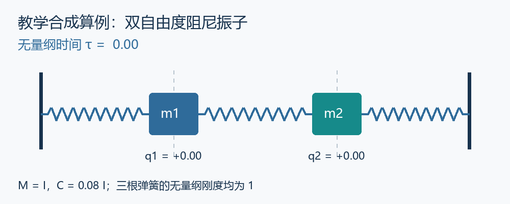
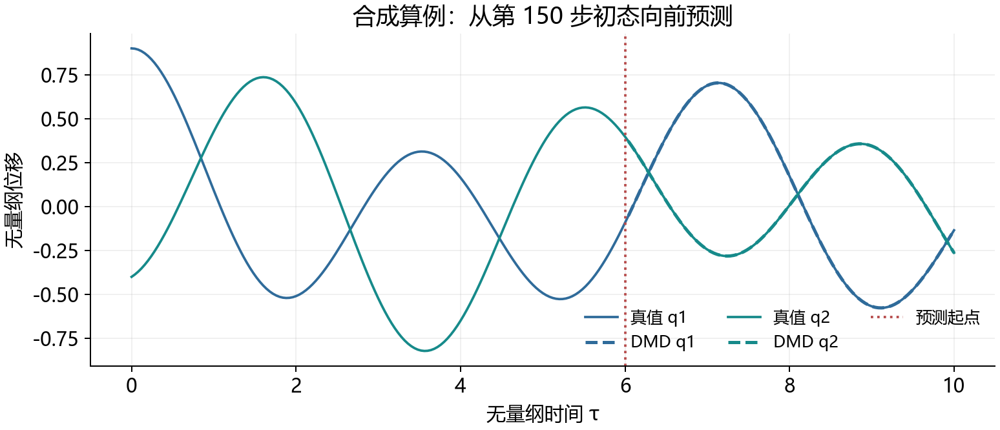
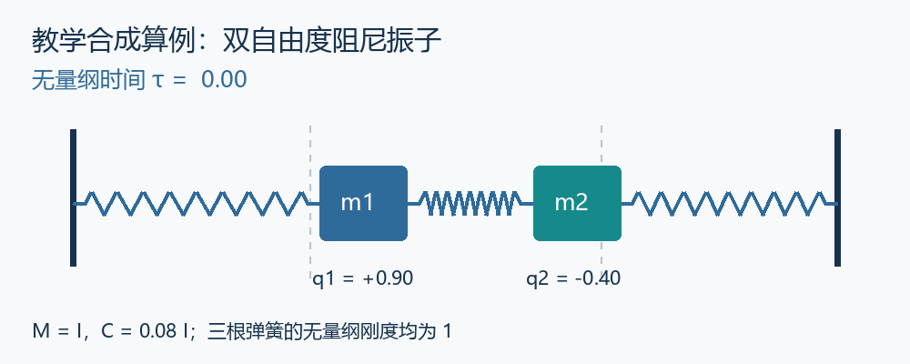
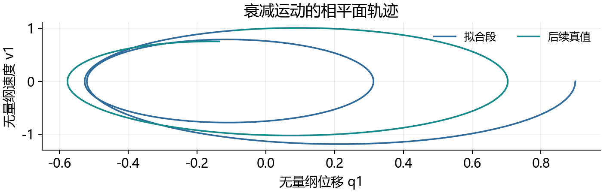
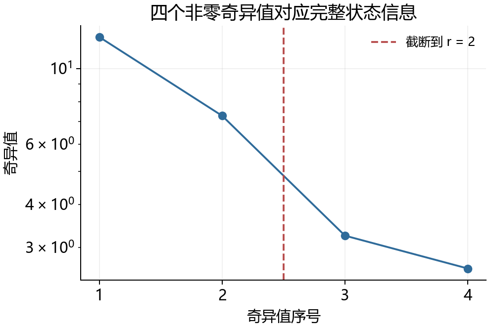
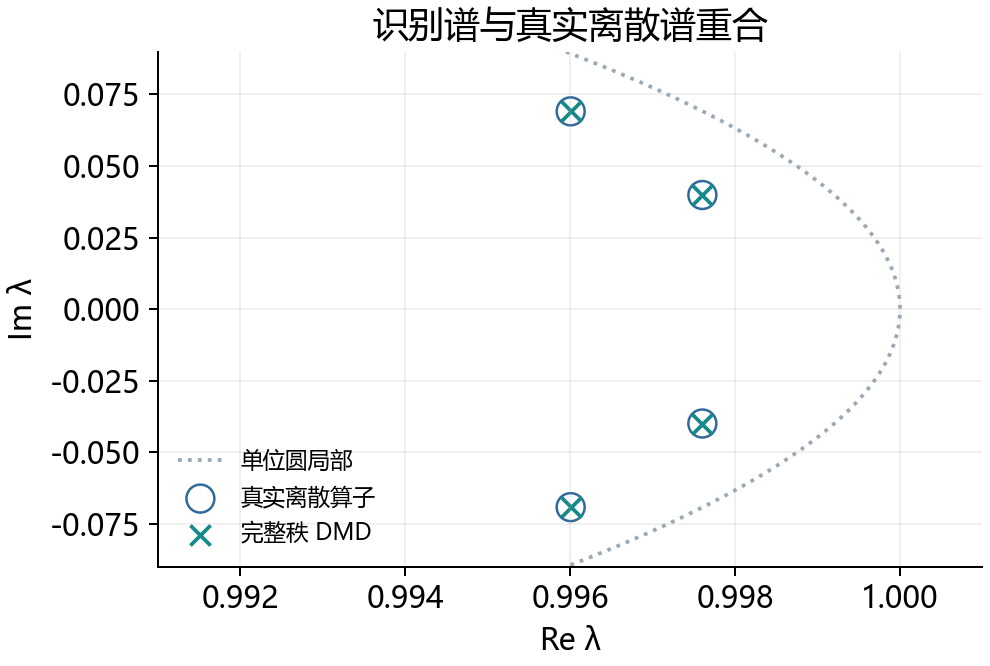
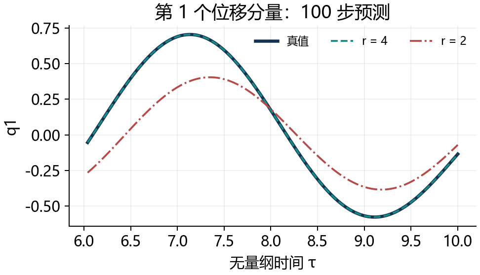
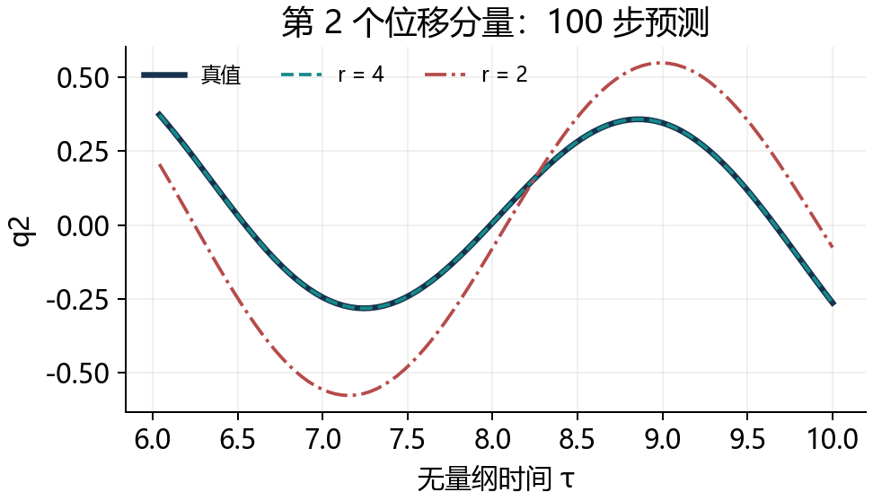

## 完整状态把二阶振子写成一阶传播 {#physical-state}

::: {.synthetic}

教学合成算例 · 无量纲 · 无噪声

:::

:::: {.grid .wide-left}

::: {.column-block}

::: {.system-image}

{alt="两个质量块、三根弹簧组成的无量纲系统示意图"}

:::

::: {.definition}

$\mathbf q=(q_1,q_2)^\top$，$\mathbf v=\mathrm d\mathbf q/\mathrm d\tau$。

$\mathbf x=\operatorname{col}(\mathbf q,\mathbf v)\in\mathbb R^4$。

:::

:::

::: {.column-block .formula-small}

$$
\mathbf q''+0.08\mathbf q'+\mathbf K\mathbf q=\mathbf0,\qquad
\mathbf K=\begin{bmatrix}2&-1\\-1&2\end{bmatrix}.
$$

$$
\frac{\mathrm d\mathbf x}{\mathrm d\tau}
=\underbrace{\begin{bmatrix}
\mathbf0&\mathbf I_2\\-\mathbf K&-0.08\mathbf I_2
\end{bmatrix}}_{\mathbf A_c}\mathbf x.
$$

::: {.band}

由状态记录估计 $\mathbf x_{m+1}\approx\mathbf A\mathbf x_m$；真实矩阵只用于生成数据与事后检查。

:::

:::

::::

## 成对快照把轨迹变成矩阵回归 {#snapshot-pairs}

$$
\begin{aligned}
\mathbf X_-&=[\,\mathbf x_0,\ \mathbf x_1,\ \ldots,\ \mathbf x_{M-1}\,]\in\mathbb R^{4\times M},\\
\mathbf X_+&=[\,\mathbf x_1,\ \mathbf x_2,\ \ldots,\ \mathbf x_M\,]\in\mathbb R^{4\times M}.
\end{aligned}
$$

::: {.band .formula}

$$
\mathbf X_+\approx\mathbf A\mathbf X_-,
\qquad \mathbf A\in\mathbb R^{4\times4}.
$$

:::

同一列对应相邻时刻，采样间隔 $\Delta\tau=0.04$。

训练：$M=150$ 对，只使用 $\mathbf x_0,\ldots,\mathbf x_{150}$。

预测检查：$\mathbf x_{151},\ldots,\mathbf x_{250}$，不参与拟合。

::: {.source}

Tu et al. (2014). Journal of Computational Dynamics. On dynamic mode decomposition: Theory and applications.

:::

## 最小二乘确定数据支撑的线性传播 {#least-squares}

$$
\min_{\mathbf A}\|\mathbf X_+-\mathbf A\mathbf X_-\|_F^2
=\min_{\mathbf A}\sum_{m=0}^{M-1}\|\mathbf x_{m+1}-\mathbf A\mathbf x_m\|_2^2.
$$

:::: {.grid}

::: {.column-block}

::: {.step}

① 紧 SVD 给出伪逆

:::

$$
\mathbf X_-=\mathbf U\mathbf\Sigma\mathbf V^*,
\qquad
\mathbf X_-^\dagger=\mathbf V\mathbf\Sigma^{-1}\mathbf U^*.
$$

::: {.definition}

仅对非零奇异值取倒数。

:::

:::

::: {.column-block}

::: {.step}

② 选择最小范数解

:::

$$
\widehat{\mathbf A}=\mathbf X_+\mathbf X_-^\dagger.
$$

::: {.definition}

数据张成空间之外的作用不能仅靠当前残差确定。

:::

:::

::::

::: {.band .formula-small}

本例为实数数据，最小二乘的一阶条件给出

$$
(\widehat{\mathbf A}\mathbf X_--\mathbf X_+)\mathbf X_-^\top=\mathbf0
\ \Longrightarrow\
\widehat{\mathbf A}\mathbf X_-\mathbf X_-^\top=\mathbf X_+\mathbf X_-^\top.
$$

若 $\operatorname{rank}\mathbf X_-=4$，则
$\widehat{\mathbf A}=\mathbf X_+\mathbf X_-^\top(\mathbf X_-\mathbf X_-^\top)^{-1}$。

:::

::: {.source}

Tu et al. (2014). Journal of Computational Dynamics. On dynamic mode decomposition: Theory and applications.

:::

## 截断 SVD 把伪逆变成小矩阵计算 {#svd-construction}

::: {.step}

① 保留前 $r$ 个奇异三元组

:::

$$
\mathbf U_r\in\mathbb C^{4\times r},\quad
\mathbf\Sigma_r\in\mathbb R^{r\times r},\quad
\mathbf V_r\in\mathbb C^{M\times r}.
$$

::: {.step}

② 先处理输出快照，得到可复用的桥接矩阵

:::

$$
\mathbf B_r=\mathbf X_+\mathbf V_r\mathbf\Sigma_r^{-1}\in\mathbb C^{4\times r}.
$$

::: {.step}

③ 得到全状态回归与下一页的小矩阵

:::

$$
\mathbf A_r=\mathbf B_r\mathbf U_r^*,
\qquad
\widetilde{\mathbf A}_r=\mathbf U_r^*\mathbf B_r\in\mathbb C^{r\times r}.
$$

::: {.source}

Tu et al. (2014). Journal of Computational Dynamics. On dynamic mode decomposition: Theory and applications.

:::

## 低维谱问题给出全状态动态模态 {#spectral-lift}

:::: {.grid}

::: {.column-block}

::: {.step}

① 求 $r\times r$ 特征问题

:::

$$
\widetilde{\mathbf A}_r\mathbf w_j
=\lambda_j\mathbf w_j.
$$

::: {.step}

② 提升回四维状态空间

:::

$$
\boldsymbol\phi_j=\mathbf B_r\mathbf w_j.
$$

::: {.definition}

$\lambda_j\ne0$，且提升向量非零。

:::

:::

::: {.column-block .formula-small}

$$
\begin{aligned}
\mathbf A_r\boldsymbol\phi_j
&=\mathbf B_r(\mathbf U_r^*\mathbf B_r)\mathbf w_j\\
&=\mathbf B_r\widetilde{\mathbf A}_r\mathbf w_j\\
&=\lambda_j\boldsymbol\phi_j.
\end{aligned}
$$

::: {.band}

小矩阵决定特征值，$\mathbf B_r$ 把特征向量送回原状态维数。

:::

:::

::::

::: {.source}

Tu et al. (2014). Journal of Computational Dynamics. On dynamic mode decomposition: Theory and applications.

:::

## 特征关系推出逐步预测式 {#modal-derivation .long-derivation}

::: {.derivation-step}

**1. 合并上一页的全部特征关系**

$$
\mathbf\Phi=[\,\boldsymbol\phi_1,\ldots,\boldsymbol\phi_r\,],\quad
\mathbf\Lambda=\operatorname{diag}(\lambda_1,\ldots,\lambda_r),
\qquad
\mathbf A_r\mathbf\Phi=\mathbf\Phi\mathbf\Lambda.
$$

下面限定本例的完整秩 $r=4$：四个独立模态组成可逆的 $\mathbf\Phi$。

:::

::: {.derivation-step}

**2. 用当前状态确定模态幅值**

$$
\mathbf\Phi\mathbf b=\mathbf x_{m_0},
\qquad \mathbf b=\mathbf\Phi^{-1}\mathbf x_{m_0},
\qquad m_0=150.
$$

数值实现用线性求解器。低秩初态拟合与任意初态的全状态传播不能无条件等同。

:::

::: {.derivation-step}

**3. 一步传播：代入初态表达**

$$
\widehat{\mathbf x}_{m_0+1}
=\mathbf A_4\mathbf x_{m_0}
=\mathbf A_4\mathbf\Phi\mathbf b
=\mathbf\Phi\mathbf\Lambda\mathbf b.
$$

:::

::: {.derivation-step}

**4. 再代入一次，得到两步与一般步数**

$$
\begin{aligned}
\widehat{\mathbf x}_{m_0+2}
&=\mathbf A_4\mathbf\Phi\mathbf\Lambda\mathbf b
=\mathbf\Phi\mathbf\Lambda^2\mathbf b,\\
\widehat{\mathbf x}_{m_0+h}
&=\mathbf\Phi\mathbf\Lambda^h\mathbf b
=\sum_{j=1}^{4}\boldsymbol\phi_j\lambda_j^h b_j.
\end{aligned}
$$

未来 $h$ 步只使用拟合模型与预测起点，不读取未来观测。

:::

::: {.derivation-step}

**5. 解释离散特征值的时间尺度**

$$
\mu_j=\frac{\log\lambda_j}{\Delta\tau}.
$$

$\operatorname{Re}\mu_j$ 描述增长或衰减；$\operatorname{Im}\mu_j$ 描述无量纲角频率。解释频率时仍需选择对数分支并考虑采样混叠。

:::

::: {.source}

Tu et al. (2014). Journal of Computational Dynamics. On dynamic mode decomposition: Theory and applications.

:::

## 预测阶段只使用当前初态与拟合模型 {#implementation}

:::: {.grid .wide-left}

::: {.column-block}

~~~python
u, s, vh = np.linalg.svd(x, full_matrices=False)
ur, vr = u[:, :r], vh.conj().T[:, :r]
bridge = (y @ vr) / s[:r]
reduced = ur.conj().T @ bridge
lam, w = np.linalg.eig(reduced)
phi = bridge @ w
operator = bridge @ ur.conj().T
~~~

:::

::: {.column-block .algorithm-list}

1. 从训练对拟合 $\mathbf A_r$。
2. 固定当前状态 $\mathbf x_{150}$。
3. 逐次计算 $\widehat{\mathbf x}_{m+1}=\mathbf A_r\widehat{\mathbf x}_m$。
4. 用未来真值评价，不把它输入预测器。

:::

::::

::: {.definition}

完整秩下，程序还核对模态展开与直接递推一致；截断秩比较统一采用直接递推。

:::

## 低残差仍需观测、秩与闭合条件支撑 {#assumptions}

::: {.compact-table}

| 检查对象 | 本例的条件 | 真实数据中应核对 |
|---|---|---|
| 状态 | 位移与速度共同组成完整状态 | 当前观测能否决定未来 |
| 数据覆盖 | $\operatorname{rank}\mathbf X_-=4$ | 激励、采样与小奇异值 |
| 线性一致性 | $\ker\mathbf X_-\subseteq\ker\mathbf X_+$ | 相同线性关系是否保持 |
| 模型 | 固定四维线性系统、无噪声 | 非线性、时变与测量噪声 |
| 谱展开 | 四个独立模态 | 零特征值、Jordan 块、初态表示 |

:::

::: {.band}

本例可检查计算链；不能据此宣称真实系统的全局预测或唯一参数恢复。

:::

::: {.source}

Tu et al. (2014). Journal of Computational Dynamics. On dynamic mode decomposition: Theory and applications.

:::

## 完整秩在教学算例中恢复离散传播 {#synthetic-results}

::: {.synthetic}

实际生成的无噪声合成数据 · 150 对拟合 · 当前状态启动未来 100 步预测

:::

::: {.wide-plot}

{alt="无量纲位移真值与完整秩 DMD 预测；竖线表示预测起点"}

:::



::: {.caption}

两项指标均为四维状态的整体 Frobenius 比值，乘 100 显示；秩 2、4 使用相同数据与递推规则。

:::

## 运动动画与相平面描述同一条轨迹 {#gif-and-image}

::: {.synthetic}

教学合成数据；GIF 每轮从同一初值重放

:::

:::: {.grid .wide-left}

::: {.column-block}

::: {.gif-image}

{alt="双自由度阻尼振子动画，显示随无量纲时间变化的两个位移"}

:::

::: {.caption}

质量块运动说明对象；画面中的位移只做显示缩放。

:::

:::

::: {.column-block}

::: {.phase-image}

{alt="同一轨迹的 q1-v1 相平面，区分拟合段与后续真值"}

:::

::: {.caption}

相平面来自同一份状态记录；定量误差仍由数据与预测比较得到。

:::

:::

::::

## 输入方向与离散谱可以分别核对 {#paired-images}

:::: {.grid .pair-images}

::: {.column-block}

{alt="训练矩阵的四个非零奇异值，标示秩 2 截断位置"}

::: {.caption}

奇异值说明输入数据覆盖与截断位置。

:::

:::

::: {.column-block}

{alt="真实离散算子与完整秩 DMD 的特征值；背景是单位圆局部弧线"}

::: {.caption}

真实谱与完整秩识别谱重合；灰线是单位圆局部。

:::

:::

::::

## 分量预测与相平面保留不同观察角度 {#three-images}

:::: {.triad-top}

::: {}

{alt="第一位移分量的真实值、秩 4 和秩 2 预测"}

:::

::: {}

{alt="第二位移分量的真实值、秩 4 和秩 2 预测"}

:::

::::

::: {.triad-bottom}

{alt="同一条衰减轨迹的位移速度相平面"}

:::

::: {.caption}

上方两图采用相同区间、颜色和图例；下方横图展示状态间关系。全部为教学合成数据。

:::

## 后续检验分别针对三个适用边界 {#next-steps}

::: {.next-item}

**噪声：**加入明确幅值的观测误差，检查奇异值、秩选择与预测敏感性。

:::

::: {.next-item}

**部分观测：**只记录位移，先验证状态是否闭合，再考虑延迟坐标。

:::

::: {.next-item}

**新初态：**固定已辨识模型，用未参与拟合的初态检验预测范围。

:::

::: {.caption}

以上为待做检验；当前结果仅覆盖本模板的线性、完整状态、无噪声教学算例。

:::
